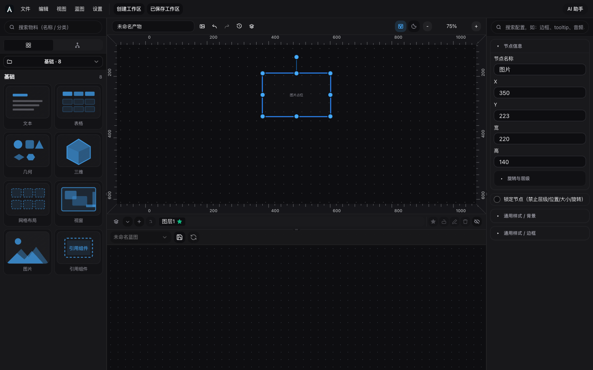

# apps/web-vue

Abuilder 的 Vue 3 演示应用，功能和 `apps/web` 对齐。不发布到 npm。

入口通过 `@arronqzy/abuilder-vue`（Veaury 封装 React `@arronqzy/abuilder`）渲染完整编辑器，与 React 演示共用同一套 UI。



## 启动

```bash
pnpm install
pnpm -C apps/web-vue dev
```

默认 `http://127.0.0.1:31012`。

入口是 `@arronqzy/abuilder-vue` 的 `<App />`。参数、工作区事件和预览模式见 [packages/abuilder-vue/README.md](../../packages/abuilder-vue/README.md)。

## 构建

```bash
pnpm -C apps/web-vue build
pnpm -C apps/web-vue preview
```

## 和 React 演示的关系

- 业务面板本体仍是 React（`react-view` / `react-blueprint` / `@arronqzy/ui`）
- Vue 侧用 Veaury `applyPureReactInVue` 包装，Vite 走 `abuilderVue()`（内置 Vue SFC + React JSX）
- 工作区、蓝图文档、Scope 模版数据格式与 `apps/web` 一致
