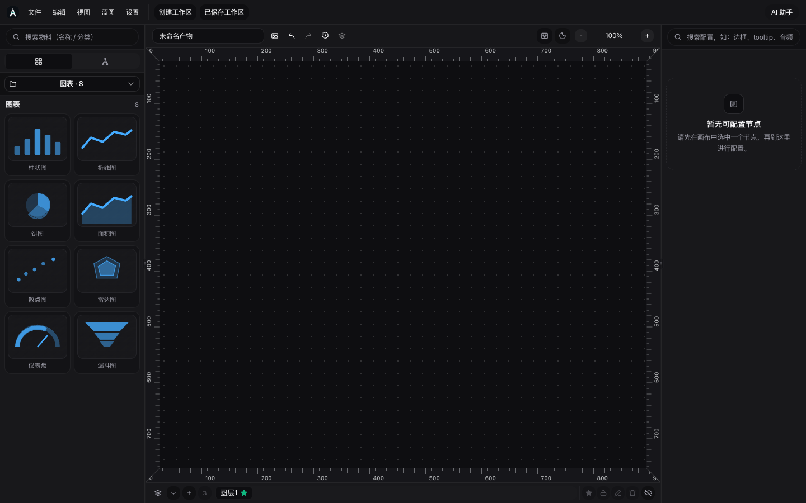

# @arronqzy/abuilder-vue

Vue 3 一站式编辑器入口，对应 React 的 `@arronqzy/abuilder`。内部用 Veaury 包装 React 实现，**宿主无需安装或配置 Veaury**。



中文全功能手册：仓库 `docs/Abuilder使用文档与功能说明.docx`。

## 安装

```bash
pnpm add @arronqzy/abuilder-vue vue react react-dom
```

需要 Vue 3.4+ 与 React 18+（编辑器本体仍是 React UI，由本包封装）。

### Vite

不要单独加 `@vitejs/plugin-vue` / 也不要碰 `veaury`。用本包导出的一站式插件：

```bash
pnpm add -D vite @vitejs/plugin-vue @vitejs/plugin-react @vitejs/plugin-vue-jsx
```

```ts
import { defineConfig } from "vite";
import { abuilderVue } from "@arronqzy/abuilder-vue/vite";

export default defineConfig({
  plugins: [
    // 内置 Vue SFC + React JSX（Veaury）与 AI（WebLLM）Vite 支持
    ...abuilderVue(),
  ],
});
```

不开 AI 时：`abuilderVue({ ai: false })`。开了 `plugins: ['ai']` 却设 `ai: false` 时，助手运行时会提示补插件。

## 最小用法

与 React 版对称——只引 `App` 和样式：

```ts
import { createApp } from "vue";
import { App } from "@arronqzy/abuilder-vue";
import "@arronqzy/abuilder-vue/styles.css";

createApp(App, {
  locale: "zh-CN",
  plugins: ["ai"],
}).mount("#app");
```

或在模板里：

```vue
<script setup lang="ts">
import { App } from "@arronqzy/abuilder-vue";
import "@arronqzy/abuilder-vue/styles.css";
</script>

<template>
  <App
    class="h-screen"
    default-theme="dark"
    locale="zh-CN"
    name-space="my-app"
    :plugins="['ai']"
    p-title="My App"
  />
</template>
```

## App 参数

| Prop | 说明 | 默认 |
|------|------|------|
| `class` | 根容器 class | — |
| `initialZoom` | 画布初始缩放 | `1` |
| `defaultTheme` | `light` / `dark` | `dark` |
| `locale` | `zh-CN` / `en-US`；省略则 localStorage → 浏览器 → 中文 | `null` |
| `nameSpace` | 隔离 IndexedDB；同一页多个 App 必须不同 | — |
| `previewSearch` | 覆盖预览 URL 查询串 | 当前 `location.search` |
| `preview` | `true` 为预览页 | `false` |
| `initialWorkspace` | 完整工作区。空则空白画布，不会自动打开 IndexedDB 记录 | — |
| `workspaceId` | 按 IndexedDB id 打开（不 remount） | — |
| `plugins` | 可选插件。目前仅 `"ai"` | `[]` |
| `pIcon` | 项目图标（URL / 资源 / `<svg>`） | — |
| `pTitle` | 写入 `document.title` | — |

可用 `ref` 拿到 `AbuilderViewHandle`（`openWorkspace` / `syncWorkspace` / `getCurrentWorkspace` 等）。

## 事件与存储 API

与 `@arronqzy/abuilder` 同名导出：`addEventSubscription`、`AbuilderEvents`、`putWorkspaceProject`、`getPreviewSnapshot` 等，从 `@arronqzy/abuilder-vue` 直接 import 即可。

## 和 React 版的差别

| | React `@arronqzy/abuilder` | Vue `@arronqzy/abuilder-vue` |
|--|--|--|
| 入口 | `<App />` | `<App />` |
| 样式 | `@arronqzy/abuilder/styles.css` | `@arronqzy/abuilder-vue/styles.css` |
| Vite | `react()` + 可选 `@arronqzy/abuilder/vite` | `abuilderVue()`（不要再加 `vue()` / veaury） |
| 额外 peer | `react` / `react-dom` | `vue` + `react` / `react-dom` |

宿主代码里不出现 `veaury`。

本仓库演示：

```bash
pnpm -C apps/web-vue dev
```

`http://127.0.0.1:31012`。

## 许可证

MIT
